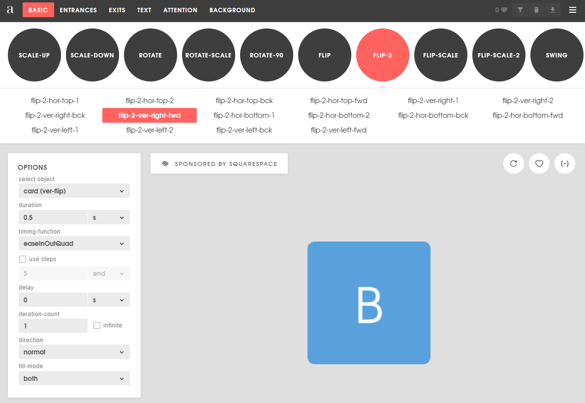

# Animations

## Les options

On peut faire jour des animations en utilisant un grand nombre de technologies, mais dans ce cours on va se concentrer sur les technologies qui font directement partie de JavaScript et CSS. Les autres technologies sont généralment des outils qui utilisent ces technologies à l'interne.

- Animations JS (Ce cours-ci)
- CSS (Prochain cours)


## Animations JS

### La base pour joueur une animation

```ts
const rotationKeyframes: Keyframe[] = [
  { transform: 'rotate(180deg)' }
];

// elementId est spécifié dans l'élément html de cette façon <div id="monId">
const element = document.getElementById(elementId);

// On fait jouer l'animation qui est décrit par le keyframes (on va voir plus de détails plus loin)
// L'animation va jouer en 1000 ms, donc 1 seconde
let animation = element?.animate(keyframes, { duration: 1000 });

// On peut attendre la fin de l'animation de cette façon
await animation?.finished;

```

Pour rendre notre vie plus simple, on va se créer une méthode qui va nous permettre de jouer nos animations facilement

```ts
const animer = async (elementId:string, keyframes: Keyframe[], durationMS:number) => {
  const element = document.getElementById(elementId);

  let animation = element?.animate(keyframes, { duration: durationMS });
  await animation?.finished;
};

// Avec cette méthode on peut maintenant écrire
await animer(`monId`, rotationKeyframes, 1000);
// Et facilement changer l'id de l'élément et la durée
await animer(`unAutreId`, rotationKeyframes, 2000);
// Ou même jouer une autre animation
await animer(`unAutreId`, translationKeyframes, 2000);
```

:::info
On va utiliser la méthode animer dans les exemples de cette page, c'est important de la comprendre
:::


### Qu'est-ce qu'on peut animer?

Voici une liste partielle des choses que l'on peut animer (On peut essentiellement animer toutes les propriétés!) et le keyframes le plus simple que l'on peut écrire pour chaque propriété

- Translation (translate)
```ts
const translationKeyframes: Keyframe[] = [
      { transform: 'translateX(100%)' }
];
```
- Rotation (rotate)
```ts
const rotationKeyframes: Keyframe[] = [
  { transform: 'rotate(180deg)' }
];
```
- Échelle (scale)
```ts
const scaleKeyframes: Keyframe[] = [
  { transform: 'scale(2)' }
];
```
- Couleur (backgroundColor, mais on peut évidemment animer les autres propriétés de couleur)
```ts
const colorKeyframes: Keyframe[] = [
  { backgroundColor: 'yellow' }
];
```
- Transparence (opacity)
```ts
const opacityKeyframes: Keyframe[] = [
  { opacity: 0 }
];
```

### Mais c'est quoi ça un keyframe?

Les clés d'animation permettent de définir les différentes valeur que vont prendre la propriété (ou les propriétés) pendant une animation.

La première chose à comprendre c'est à quel moment ces valeurs vont être appliqué selon le nombre de paramètres.

#### Cas 1: Il y a une seule valeur dans l'array 

```ts
const translationKeyframes: Keyframe[] = [
  { transform: 'translateX(100%)' }
];
```

La proprété transform va valoir sa valeur sans animation au début et va **terminer** avec une translation en X équivalente à 100% de sa taille. (On pourrait utiliser un nombre de pixels)
Bref: C'est la valeur finale!

#### Cas 2: Il y a deux valeurs dans l'array 

```ts
const translationKeyframes: Keyframe[] = [
  { transform: 'translateX(-100%)' },
  { transform: 'translateX(100%)' }
];
```

La proprété transform va appliquer instantanément une translation de -100% et va **terminer** avec une translation de 100%
Bref: La première valeur c'est le début et la deuxième c'est la fin

#### Cas 3: Il y a 3 valeurs dans l'array 

```ts
const translationKeyframes: Keyframe[] = [
  { transform: 'translateX(-200%)' },
  { transform: 'translateX(0%)' },
  { transform: 'translateX(100%)' }
];
```

La proprété transform va appliquer instantanément une translation de -200% et va **terminer** avec une translation de 100%

Mais qu'est-ce qui se passe entre les deux???

Pour s'aider on va donner une durée à l'animation, par exemple 2 secondes.

Donc le premier va logiquement arriver au moment 0 seconde.
Le dernier va logiquement arriver au moment 2 secondes (la fin).
Et celui du millieu? Et bien au millieu, à 1 seconde.

C'est important de comprendre que cette animation n'est plus à vitesse constante! Pourquoi?

On se déplace de 200% pendant la première seconde (-200% à 0%) et de 100% pendant la deuxième seconde (0% à 100%)


## CSS

### Comment ça marche

- Principalement on change une propriété CSS
- On décide combien de temps dure transition

### Exemple

- On change la propriété **top** de 0px à 20px en 0.2 seconde, voilà une animation qui fait descendre un objet de 20 pixels en 0.2 seconde.

### Keyframes

- On peut avoir différentes étapes à notre animation
- Ces étapes sont des Keyframes

### Utiliser avec Angular

- Il faut commencer par créer l'animation en CSS

```css
@keyframes attack {
  0% {
    transform: translateY(0%);
  }
  20% {
    transform: translateY(10%);
  }
  60% {
    transform: translateY(-50%);
  }
  100% {
    transform: translateY(0%);
  }
}
```

- Ensuite on assigne l'animation à une classe CSS

```css
.attack {
  animation: attack 0.5s;
  -webkit-animation: attack 0.5s;
  //C'est peut-être overkill de mettre toutes les autres, mais 🤷‍♂️
  -moz-animation: attack 0.5s;
  -o-animation: attack 0.5s;
  -ms-animation: attack 0.5s;
}
```

- Finalement, on peut assigner la classe CSS avec une condition

```html
<app-card [class.attack]="mycard.attack===true"></app-card>
```

## Angular animations

### ng-animate

- Librairie Angular pour les animations: https://www.npmjs.com/package/ng-animate
- [Page pour voir les animations](https://jiayihu.github.io/ng-animate/)

### Exemple

```ts
@Component({
  selector: "my-component",
  templateUrl: "my-component.component.html",
  animations: [
    trigger("montrigger", [transition("* => *", useAnimation(bounce))]),
  ],
})
export class MyComponent {
  mavariable: any;
}
```

- Dans le html

```html
<div [@montrigger]="mavariable"></div>
```

### Trigger

- C'est ce qui va permettre de déclencher l'animation

```ts
animations: [
    trigger('montrigger',
      [transition('* => *', useAnimation(bounce))]
    )
],
```

### Transition

- C'est le changement sur la variable qui va déclencher l'animation
  '_ => _' signifie n'importe quel changement d'état

- On peut également mettre des ':increment' ou ':decrement'

```ts
animations: [
    trigger('bounce', [transition(':increment', useAnimation(bounce))]),
    trigger('shake', [transition(':decrement', useAnimation(shake))])
],
```

```html
<div [@shake]="mavariable" [@bounce]="mavariable"></div>
```

### useAnimation

- Dans les exemples, on utilise une animation prédéfinie, mais on pourrait également créer nos propres animations avec des keyframes

## Générateur d'animations CSS

- Le site **animista** contient des centaines d'animations que l'on peut modifier avec des paramètres pour générer nos keyframes.

[https://animista.net](https://animista.net)

|  |
| ------------------------- |

## Délais

Quand on parle d'animation, on parle presque toujours de délais. Surtout lorsque l'on fait des séquences d'animations.

Dans l'exemple suivant, on voit que l'on met bounce à true et on le met à false après 1000 ms (donc 1 seconde).

```ts
bounceMe() {
  this.bounce = true;
  setTimeout(() => {this.bounce = false;}, 1000);
}
```

On imagine qu'une animation est déclenchée quand la valeur de la variable bounce change (comme dans l'exemple complet un peu plus bas.)

:::warning
Sans le **setTimeout**, l'animation joue correctement la première fois, mais comme le système détecte les changements, rien ne se passe la 2e fois que l'on clique, car bounce est **ENCORE** à true.
:::

:::danger
Sans le **setTimeout**, on obtient des résultats encore **PLUS** bizarres. Par exemple, en jouant une autre animation, on risque d'avoir un **bounce** en plus à la fin, car le système va réévaluer les animations après en avoir terminé une. En résumé, il faut utiliser un setTimeout de la même durée que notre animation pour remettre cette valeur à false.
:::

## Exemple

Un exemple qui montre comment utiliser à la fois des animations Angular et des animations css générées avec **animista**

import Tabs from "@theme/Tabs";
import TabItem from "@theme/TabItem";

<Tabs>
  <TabItem value="app.component.ts" label="app.component.ts" default>
    ```ts
    import { Component } from '@angular/core';
    import {transition, trigger, useAnimation} from "@angular/animations";
    import {bounce, shake} from "ng-animate";

    @Component({
      selector: 'app-root',
      templateUrl: './app.component.html',
      styleUrls: ['./app.component.css'],
      animations:[
        trigger('bounce', [
          transition(':increment', useAnimation(bounce, {
            // Set the duration to 3 seconds and delay to 1 second
            params: { timing: 3, delay: 1 }
          }))
        ]),
        trigger('shake', [
          transition(':decrement', useAnimation(shake))]
        )
      ]
    })
    export class AppComponent {

      mavariable = 0;
      shake= false;
      bounce = false;

      constructor() {
      }

      shakeMe() {
        this.shake = true;
        setTimeout(() => {this.shake = false;},1000);
      }

      bounceMe() {
        this.bounce = true;
        setTimeout(() => {this.bounce = false;},1000);
      }
    }
    ```

  </TabItem>
  <TabItem value="app.component.html" label="app.component.html">
    ```html
    <div style="padding: 20px">
      <h1>Animation CSS</h1>
      <button (click)="shakeMe()" mat-raised-button color="accent" style="margin-right: 10px">Shake</button>
      <button (click)="bounceMe()" mat-raised-button color="primary">Bounce</button>
      <div [class.bounce-top]="bounce" [class.shake-top]="shake" style="height: 100px; width: 100px; background-color: aqua; margin: 20px"></div>
    </div>
    <div style="padding: 20px">
      <h1>Animation Angular</h1>
      <button (click)="mavariable = mavariable - 1" mat-raised-button color="accent" style="margin-right: 10px">Shake</button>
      <button (click)="mavariable = mavariable + 1" mat-raised-button color="primary">Bounce</button>
      <div [@shake]="mavariable" [@bounce]="mavariable" style="height: 100px; width: 100px; background-color: aqua; margin: 20px"></div>
    </div>
    ```

  </TabItem>
  <TabItem value="app.component.css" label="app.component.css">

    ```css
    .shake-top {
      -webkit-animation: shake-top 0.8s cubic-bezier(0.455, 0.030, 0.515, 0.955) both;
      animation: shake-top 0.8s cubic-bezier(0.455, 0.030, 0.515, 0.955) both;
    }

    /* ----------------------------------------------

    - Generated by Animista on 2023-9-7 15:7:40
    - Licensed under FreeBSD License.
    - See http://animista.net/license for more info.
    - w: http://animista.net, t: @cssanimista
    - ---------------------------------------------- */

    /* animation shake-top */

    @-webkit-keyframes shake-top {
      0%,
      100% {
        -webkit-transform: rotate(0deg);
        transform: rotate(0deg);
        -webkit-transform-origin: 50% 0;
        transform-origin: 50% 0;
      }
      10% {
        -webkit-transform: rotate(2deg);
        transform: rotate(2deg);
      }
      20%,
      40%,
      60% {
        -webkit-transform: rotate(-4deg);
        transform: rotate(-4deg);
      }
      30%,
      50%,
      70% {
        -webkit-transform: rotate(4deg);
        transform: rotate(4deg);
      }
      80% {
        -webkit-transform: rotate(-2deg);
        transform: rotate(-2deg);
      }
      90% {
        -webkit-transform: rotate(2deg);
        transform: rotate(2deg);
      }
    }
    @keyframes shake-top {
      0%,
      100% {
        -webkit-transform: rotate(0deg);
        transform: rotate(0deg);
        -webkit-transform-origin: 50% 0;
        transform-origin: 50% 0;
      }
      10% {
        -webkit-transform: rotate(2deg);
        transform: rotate(2deg);
      }
      20%,
      40%,
      60% {
        -webkit-transform: rotate(-4deg);
        transform: rotate(-4deg);
      }
      30%,
      50%,
      70% {
        -webkit-transform: rotate(4deg);
        transform: rotate(4deg);
      }
      80% {
        -webkit-transform: rotate(-2deg);
        transform: rotate(-2deg);
      }
      90% {
        -webkit-transform: rotate(2deg);
        transform: rotate(2deg);
      }
    }

    .bounce-top {
      -webkit-animation: bounce-top 0.9s both;
      animation: bounce-top 0.9s both;
    }

    /* ----------------------------------------------

    - Generated by Animista on 2023-9-7 15:8:5
    - Licensed under FreeBSD License.
    - See http://animista.net/license for more info.
    - w: http://animista.net, t: @cssanimista
    - ---------------------------------------------- */

    /* animation bounce-top */
    @-webkit-keyframes bounce-top {
      0% {
        -webkit-transform: translateY(-45px);
        transform: translateY(-45px);
        -webkit-animation-timing-function: ease-in;
        animation-timing-function: ease-in;
        opacity: 1;
      }
      24% {
        opacity: 1;
      }
      40% {
        -webkit-transform: translateY(-24px);
        transform: translateY(-24px);
        -webkit-animation-timing-function: ease-in;
        animation-timing-function: ease-in;
      }
      65% {
        -webkit-transform: translateY(-12px);
        transform: translateY(-12px);
        -webkit-animation-timing-function: ease-in;
        animation-timing-function: ease-in;
      }
      82% {
        -webkit-transform: translateY(-6px);
        transform: translateY(-6px);
        -webkit-animation-timing-function: ease-in;
        animation-timing-function: ease-in;
      }
      93% {
        -webkit-transform: translateY(-4px);
        transform: translateY(-4px);
        -webkit-animation-timing-function: ease-in;
        animation-timing-function: ease-in;
      }
      25%,
      55%,
      75%,
      87% {
        -webkit-transform: translateY(0px);
        transform: translateY(0px);
        -webkit-animation-timing-function: ease-out;
        animation-timing-function: ease-out;
      }
      100% {
        -webkit-transform: translateY(0px);
        transform: translateY(0px);
        -webkit-animation-timing-function: ease-out;
        animation-timing-function: ease-out;
        opacity: 1;
      }
    }
    @keyframes bounce-top {
      0% {
        -webkit-transform: translateY(-45px);
        transform: translateY(-45px);
        -webkit-animation-timing-function: ease-in;
        animation-timing-function: ease-in;
        opacity: 1;
      }
      24% {
        opacity: 1;
      }
      40% {
        -webkit-transform: translateY(-24px);
        transform: translateY(-24px);
        -webkit-animation-timing-function: ease-in;
        animation-timing-function: ease-in;
      }
      65% {
        -webkit-transform: translateY(-12px);
        transform: translateY(-12px);
        -webkit-animation-timing-function: ease-in;
        animation-timing-function: ease-in;
      }
      82% {
        -webkit-transform: translateY(-6px);
        transform: translateY(-6px);
        -webkit-animation-timing-function: ease-in;
        animation-timing-function: ease-in;
      }
      93% {
        -webkit-transform: translateY(-4px);
        transform: translateY(-4px);
        -webkit-animation-timing-function: ease-in;
        animation-timing-function: ease-in;
      }
      25%,
      55%,
      75%,
      87% {
        -webkit-transform: translateY(0px);
        transform: translateY(0px);
        -webkit-animation-timing-function: ease-out;
        animation-timing-function: ease-out;
      }
      100% {
        -webkit-transform: translateY(0px);
        transform: translateY(0px);
        -webkit-animation-timing-function: ease-out;
        animation-timing-function: ease-out;
        opacity: 1;
      }
    }

    ```

  </TabItem>
</Tabs>

## Github

Le code de cet [exemple](https://github.com/CEM-420-5W5/animations-info).
