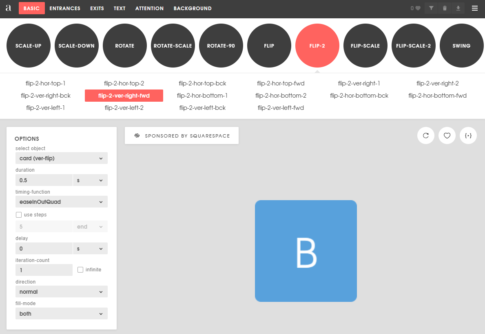

# Animations CSS

## Objectif

Apprendre à utiliser des animations CSS qui permettent de rouler des animations de façon plus efficace, mais avec moins de contrôle.


## CSS

### Comment ça marche

- Principalement on ajoute une classe à la liste de classe d'un élément
- L'animation est spécifié dans une classe css qui spécifie la durée et si on utilise forwards ou pas (Pour garder la valeur à la fin)

### Keyframes

- On peut avoir différentes étapes à notre animation et ces étapes se nomment encore une fois des keyframes
- Ils fonctionnent de la même façon que pour les animations JS, même si la syntaxe est un peu différente

### Exemple

- On change la propriété **top** de 0px à 20px en 0.2 seconde, voilà une animation qui fait descendre un objet de 20 pixels en 0.2 seconde.

### Utiliser avec React

- Il faut commencer par créer l'animation en CSS avec des keyframes
- L'animation suivante fait bouger en Y de 10% après 20% du temps et ensuite bouger à -50% après 60% du temps epour ensuite retourner à la position de départ.

```css
@keyframes attackKeyframes {
  0% {
    transform: translateY(0%);
  }
  20% {
    transform: translateY(10%);
  }
  60% {
    transform: translateY(-50%);
  }
  100% {
    transform: translateY(0%);
  }
}
```

- Ensuite on assigne les keyframes à l'animation d'une classe CSS en spécificant la durée et potentiellement l'option forwards

```css
.attack {
  animation: attackKeyframes 0.5s;
  -webkit-animation: attackKeyframes 0.5s;
}
```

- Finalement, on peut assigner la classe CSS à l'élément

```ts
const element = document.getElementById(elementId);
element?.classList.add(classe);
```

## Les problèmes!

### Rejouer la même animation

Ça serait merveilleux si c'était aussi simple, mais comme on peut le voir dans le premier exemple du repository fournis à la fin de cette page, on a rapidement un problème quand on veut faire jouer l'animation une 2e fois!

Pourquoi? Car la ligne suivante n'a AUCUN effet si la classe est déjà présente sur l'élément!

```ts
element?.classList.add(classe);
```

Pour cette raison, les animations CSS sont un bon choix pour reflèter un état. Par exemple animer un fadeIn ou fadeOut selon si un objet devrait être affiché ou non. On jouer une animation quand on passe la souris sur un élément et autres exemples du genre. Pourquoi? Car on peut alors facilement avoir 2 listeners:

```ts
box.addEventListener('mouseenter', () => {
  box.classList.add(classeAnimation);
});

// Triggers when the mouse leaves the element
box.addEventListener('mouseleave', () => {
  box.classList.remove(classeAnimation);
});
```

### Est-ce qu'on peut quand même jouer une animation plusieurs fois avec CSS?

Quelle excellente question! Je suis content que vous me la posiez!

On peut retirer la classe juste avant de l'ajouter, mais il faut connaître la petite astuce. Cette façon ne fonctionne pas!

```ts
element?.classList.remove(classe);
element?.classList.add(classe);
```

Mais celle-ci oui! Je passe les détails, mais dans le premier cas on remet dans le même état avant que la liste de classes soient évalué.

```ts
element.classList.remove(classe);
// Forcer le reflow pour que l'animation puisse être relancée
// Ou en language plus simple, un hack JS qui fonctionne particulièrement bien si vous n'oubliez pas de faire brûler des poils de chats dans la flamme d'une chandelle à chaque plein lune (chandelle et poils de chat non inclus)
void element.offsetWidth;
element.classList.add(classe);
```

### On fait comment si on veut jouer une séquence d'animations?

Comment on fait pour jouer des séquences d'animations? Est-ce que ça serait même utile de mettre un await devant le add au classList?

JS fournit des tonnes des listeners et on peut les utiliser pour savoir quand une animation se termine avec quelque chose comme ceci:

```ts
element?.classList.add(classe);
element.addEventListener('animationend', () => {
  // Faire quelque chose à la fin de l'animation
});
```

:::warning
Ça fonctionne bien dans un cas simple, mais on peut rapidement tomber sur un problème. Le listener est sur l'élément en général, pas sur une animation en particulier. Imaginez que quelqu'un d'autre décide de joueur une autre animation sur le même élément ailleurs dans son code! C'est le genre de code qui peut causer des problèmes vraiment difficiles à prévoir et comprendre... Bref, soyez prudent avec ce genre de logique.
:::

Mais voici donc à quoi ressemblerait notre méthode:

```ts
const jouerAnimationAvecCallback = (elementId: string, classe: string, callback: () => void) => {
  const element = document.getElementById(elementId);
  if (!element) {
    return;
  }

  element.classList.add(classe);

  element.addEventListener('animationend', () => {
    element.classList.remove(classe);
    callback();
  }, { once: true });
};

// Et vous pourriez l'utiliser comme ceci:
jouerAnimationAvecCallback("monId", "classe", () => {
  jouerAnimationAvecCallback("monId", "autreClasse", () => {
    alert("les animations sont terminés")
  });
});
```

:::danger
Mais qu'est-ce qui se passe quand on appele pleins de fois addEventListener sur le même élément? Et bien on va ajouter plusieurs event listeners! Donc il **faudrait** retirer le event listener dans "animationend"... Mais ça devient franchement compliqué et on va donc arrêter là!
:::

:::danger
Est-ce que j'ai mentionné que si vous ajoutez deux classes pour animer en même temps, seulement celle qui est la dernière dans les déclarations CSS s'appliquent! Donc pas possible de joueur 2 animations en même temps non plus...
:::

:::info
C'est parcontre possible de faire une seule animation avec une séquence complexe qui modifient plusieurs chosent différentes!
:::

Donc en résumé, c'est préférable de ne pas utiliser les animations CSS pour les cas complexes avec des séquences qui dépendant de notre logique. Mais les animations CSS peuvent être une bonne façon d'animer plus efficacement les cas simples!


## Générateur d'animations CSS

- Le site **animista** contient des centaines d'animations que l'on peut modifier avec des paramètres pour générer nos keyframes css. Ils permettent d'ajouter un grand nombre d'effets intéressants et fonctionnent très bien.

[https://animista.net](https://animista.net)

|  |
| ------------------------- |

## Repo avec les exemples

Vous pouvez voir de nombreux exemples metionnées sur cette page sur ce [repo](https://github.com/CEM-420-5W5/css-animations-info).