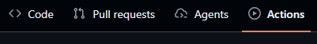
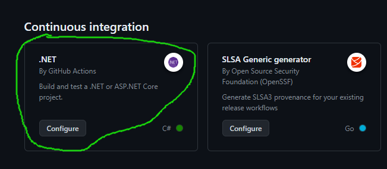
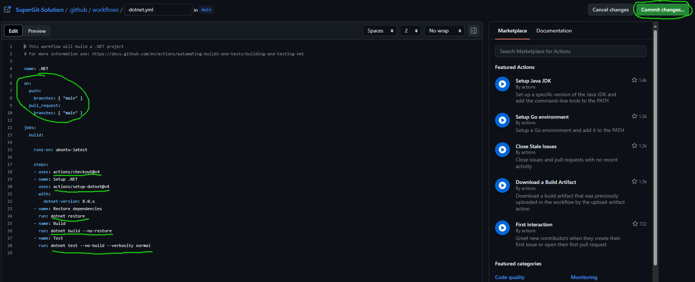
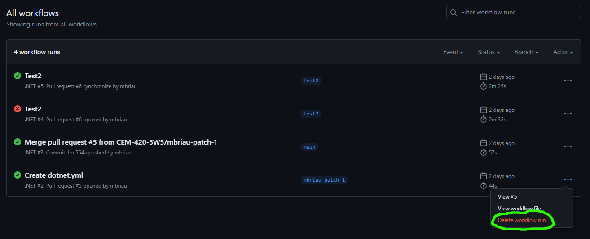
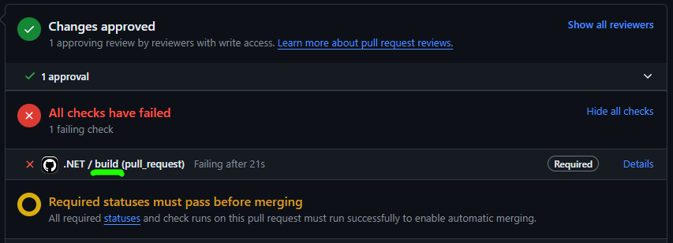

# Actions sur GitHub

## Objectif

- Apprendre à ajouter une action sur GitHub. 
- Les actions permettent de faire des tâches intéressantes et de les **automatiser**

:::info
L'exemple est une action qui roule les tests unitaires, mais il y a de très nombreuses options d'actions! 
:::

## Les étapes

Pour ajouter une action à votre workflow, cliquez sur le menu **Actions** entre Pull requests et Projects.

On va choisir une action de tests unitaires .NET (On va reparler de **Continuous Integration** dans un autre cours)

||
|-|

:::warning
Prenez bien l'action qui est dans la section **CONTINUOUS INTEGRATION**
:::

Les options par défaut font bien ce que l'on veut, sauf pour la version de .Net qui doit être modifiée pour 10 au lieu de 8.

:::warning
Changer la vesion de .Net pour 10 au lieu de 8
:::

||
|-|

Si on regarde le contenu on voit que l'action var :

- Faire un checkout
- Faire un setup de dotnet
- Mettre à jour les dépendances
- Builder le projet
- Rouler les tests

Et ça se fait chaque fois qu'un push est fait vers main ou chaque fois qu'on va créer un Pull Request vers main.

On peut ensuite cliquer sur **Commit Changes...**

## Nettoyage

:::danger
Chaque fois qu'une tâche roule, elle laisse derrière un **artefact**. Ça prend de l'espace mémoire et c'est important de les effacer régulièrement, sinon ça coûte de l'argent avec un compte payant OU on risque d'atteindre rapidement la limite d'un compte gratuit!
:::

||
|-|

Maintenant On peut seulement accepter le Pull Request si l'action de build (qui roule également les tests) est un succès

||
|-|
