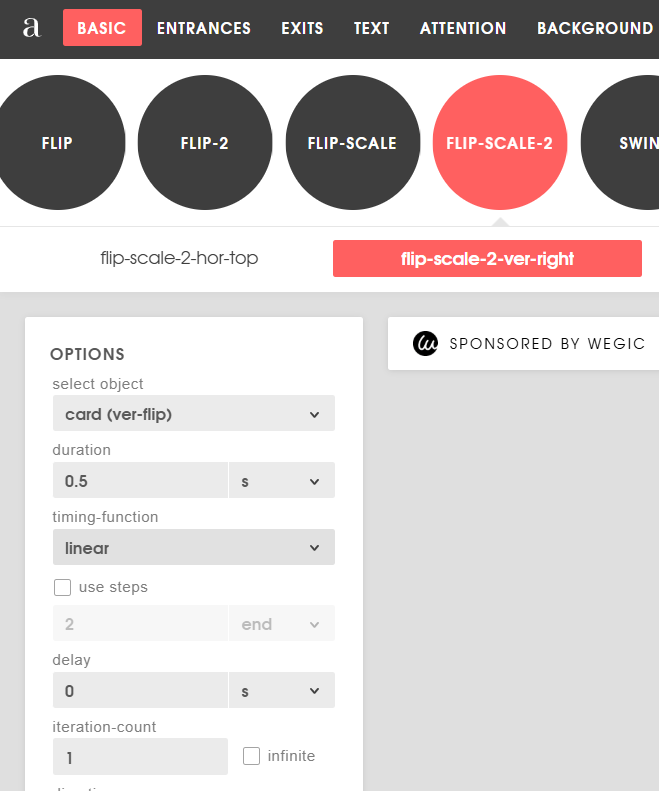
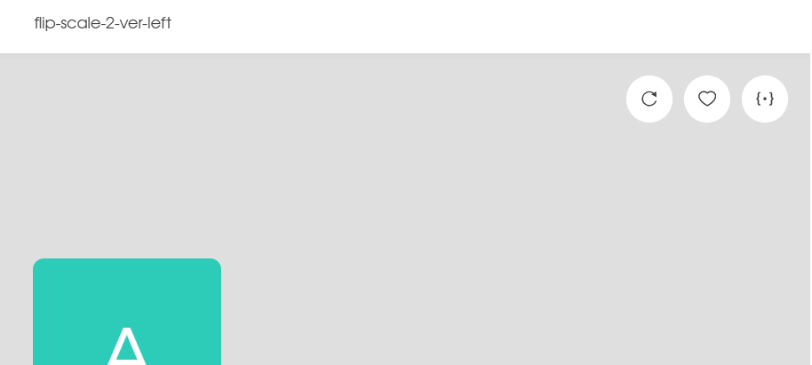

# Animations CSS

## Objectifs

Utiliser des animations CSS pour animer des cartes.

[Projet](https://github.com/CEM-420-5W5/css-animations-exercice)

## État initial

Le projet est déjà assez complet, mais il faut faire quelques modifications à chaque étape

## Complétez les tâches suivantes

### Faire apparaître la carte

Ici on va utiliser la propriété className pour mettre fade-in directement sur l'élément dans le JSX

### Faire disparaître la carte

On va travailler un peu plus cette fois-ci.

Premièrement créer une animation fade-out dans le fichier **animations.css** (il faut créer la classe et les keyframes). C'est assez simple, faites le contraire du fade-in!

Dans la méthode afficherCarte, il faut faire quelque chose quand la valeur est false (pour la cacher).
Premièrement, trouvez l'élément et ensuite ajoutez-lui la classe fade-out que vous venez de créer.

Ça ne fonctionne pas? Ça serait mieux d'attendre que l'animation soit terminé avant d'exécuter la ligne setCardVisible, sinon l'élément disparaît instantanément!

Gardons ça simple avec une autre stratégie qui fonctionne bien dans ces cas simples:

```ts
// On attend 500 ms avec ce code (la méthode doit être async)
await new Promise(resolve => setTimeout(resolve, 500));
```

### Faire jouer une animation d'attaque

Dans la méthode **jouerAttaque**, on peut obtenir l'élément avec son id en fonction de la variable side.

On peut ensuite ajouter la classe d'animation pour jouer la bonne animation d'attaque (player-attack ou opponent-attack)

:::warning
Êtes-vous capable de jouer les animations plusieurs fois? Si non, allez-y avec la première solution présenté en classe.
:::

:::danger
On montre comment le faire avec une animation CSS, mais ça sera sans doute plus facile de le faire avec une animation JS dans votre TP
:::

### Afficher une animation autour de la carte quand on peut la jouer

Pas de méthode à modifier ici, on va uniquement définir le className des cartes de cette section en fonction du coût en mana de la carte et de la variable mana.

La classe card-can-be-played permet d'afficher une bordure animée en boucle

### Activer un pouvoir sur une carte

Ici c'est presque exactement le même problème que pour jouer une attaque. Mais comment bien identifier les différents pouvoirs?

Modifier la propriété id des pouvoirs pour qu'elle soit vraiment unique dans le fichier **playing-card.tsx**. Le truc c'est de combiner le id de la carte avec celui du pouvoir!

Modifiez ensuite **activatePower** pour jouer les animations.

Utilisez les variables **selectedCardId** et **selectedPowerId**

:::warning
Êtes-vous capable d'animer les pouvoirs plusieurs fois? Utilisez encore le même fix.
:::

:::danger
On montre comment le faire avec une animation CSS, mais ça sera sans doute plus facile de le faire avec une animation JS dans votre TP
:::

### Piger une carte

Prenez déjà un instant pour regarder le projet dans son état actuelle en cliquant sur piger et réinitialiser quelques fois.

Quand on pige une carte, on peut voir que la carte apparaît instantannément à l'endroit où elle va être une fois qu'elle va être pigé.

On va utiliser le site animista pour une animation qui nous permet de piger une carte.

On va commencer par aller sur le site et choisir les options suivantes:



- Flip-Scale-2
    - flips-scale-2-ver-right

Cliquer ensuite sur le bouton rond complètement à droite \{.\}



Et faites COPY CLASS et copié le dans le fichier d'animations CSS

Et faites COPY KEFRAMES et copié les lignes aussi

On a maintenant une animation, mais il y a beaucoup plus de lignes que nécessaires avec cette histoire de webkit.
On va:
    - Effacer la ligne avec webkit de la classe
    - Effacer le @-webkit-keyframes au complet (donc la moitié du code de keyframes copié)
    - Effacer une ligne sur 2 du @keyframes qui reste. Vous l'aurez deviné. Toutes les lignes qui commencent par -webkit

Ça devrait vous donner la chose suivante:

```ts
@keyframes flip-scale-2-ver-right {
  0% {
            transform: translateX(0) rotateY(0) scale(1);
            transform-origin: 100% 50%;
  }
  50% {
            transform: translateX(50%) rotateY(-90deg) scale(2);
            transform-origin: 50% 50%;
  }
  100% {
            transform: translateX(100%) rotateY(-180deg) scale(1);
            transform-origin: 0% 50%;
  }
}
```

Il faut faire quelques changements car l'animation qu'on a pris fait partir du côté face vers le côté pile, donc on va voir le DOS de la carte après l'animation.
Vous pouvez prendre le temps de la modifier vous même ou vous sauvez l'effort et utiliser le code suivant.

Explications:
- On veut montrer le dos de la carte au début de l'animation, on commence donc avec un rotateY(-180 et on termine à 0)
- La transformation de l'origine est difficile à expliquer, mais c'est ce qui donne un effect intéressant. Au lieu de pivoter par rapport au centre de la carte, on pivote par rapport à un côté de la carte et le point de rotation se déplace pendant que l'animation joue! (oui, oui, je sais, c'est compliqué, mais c'est beau). Comme on fait tout à l'envers, on va changer le transform-origin et le translateX.

:::warning
Rassurez-vous, pas besoin de comprendre tout ces détails. Dans le cours on ne va jamais faire des modifications d'animations aussi complexes!
:::


```ts
@keyframes flip-scale-2-ver-right {
  0% {
            transform: translateX(100%) rotateY(-180deg) scale(1);
            transform-origin: 0% 50%;
  }
  50% {
            transform: translateX(50%) rotateY(-90deg) scale(2);
            transform-origin: 50% 50%;
  }
  100% {
            transform: translateX(0) rotateY(0) scale(1);
            transform-origin: 100% 50%;
  }
}
```


On a maintenant une belle animation plus lisible et on va aller la mettre sur l'objet qu'on veut animer en modifiant le fichier animation-css.tsx. L'élément qui a l'id "simple_c42". On ajoute simplement le className, donc:

```ts
className="flip-scale-2-ver-right"
```

Quand on pige une carte, on peut voir que la carte s'anime, mais elle est déjà en haut. L'animation contient un flip, mais pas encore de translation, on va devoir la modifier!

Il faut la déplacer de 190px en y en utilisant translateY. Essayez par vous même!

:::warning
L'explication suivante dépasse ce qui est nécessaire de comprendre dans le cours. C'est simplement là pour ceux qui sont curieux.
:::

C'est un concept qu'on utilise souvent dans ce type d'animation! Quand il y a plusieurs éléments dans une liste qui est animé et qu'on insère un élément à l'intérieur, la position des éléments est instantannément mise à jour. Ce que l'on fait c'est donc d'animer à l'envers d'une certaine façon. Comme l'élément est déjà où il va terminer, on fait que le début de l'animation le déplace vers l'endroit où il était avant et l'animation le redéplace vers la position où il est déjà! (Ça va être plus simple à comprendre en faisant l'exemple!)

:::danger
Fin de l'explication pas évidente! (1ère partie)
:::

La solution ajouter ceci sur la ligne du transform du 0%:

```ts
 translateY(190px)
 ```

Et ceci sur la ligne du transform du 100%:

```ts
 translateY(0px)
 ```

 ### Piger une carte complexe

 Encore une fois, vous pouvez voir que tout se déroule de façon instantanné.

 On va commencer par ajouter l'animation pour piger la carte. On va donc un peu plus bas dans le fichier animation-css.tsx avec la partie if(index ===0)

 Même chose:

 ```ts
className="flip-scale-2-ver-right"
```

Si tout va bien, on pige bien la carte, mais il n'y a pas d'animation pour le déplacement vers la droite des cartes qui sont déjà là!

Ajoutons donc la classe d'animation slide-right pour les animer aussi. Elles sont juste un peu plus bas dans le fichier.

```ts
className="slide-right"
```

Si tout va bien, elle s'anime correctement.

:::info
Si vous regardez le keyframe de l'animation, vous allez voir qu'on fait encore la même chose. Comme la carte est déjà au bon endroit, le moment 0% est déplacé vers la gauche et le moment 100% n'a pas de translation!
:::

Mais il reste un bug visuel! On dirait que la carte passe à travers l'autre quand on la pige!

Comment on règle ça? Il faut indiquer que la carte animé doit être dessiné après la carte du deck. Pour faire ça on utilise le z-index.

Modifiez l'animation .flip-scale-2-ver-right en ajoutant z-index: 5

```ts
.flip-scale-2-ver-right {
  animation: flip-scale-2-ver-right 0.5s linear both;
  z-index: 5;
}
```

:::info
Pourquoi 5??? Pourquoi pas! On veut juste un chiffre plus grand que 0 (la valeur par défaut)
Ce qu'il faut comprendre c'est que le système qui affiche commence par afficher les éléments avec les plus petit z-index et termine avec les plus gros.
:::

:::info
Rien à voir avec le cours, mais en programmation 3D il existe à la fois un z-index qui fonctionne de façon similaire ET un z-buffer qui fonctionne de façon plus complexe et qui permet essentiellement de connaître la distance entre la caméra et chacun des pixels présentement affiché. C'est utilisé dans de très nombreux effets 3D.
:::

## Solution

La solution est dans la branche **solution** du repo
